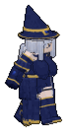
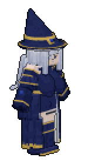
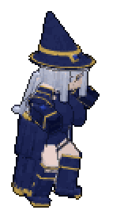
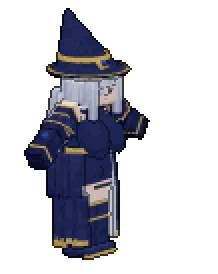
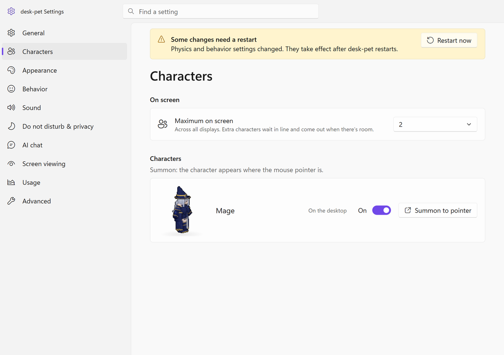
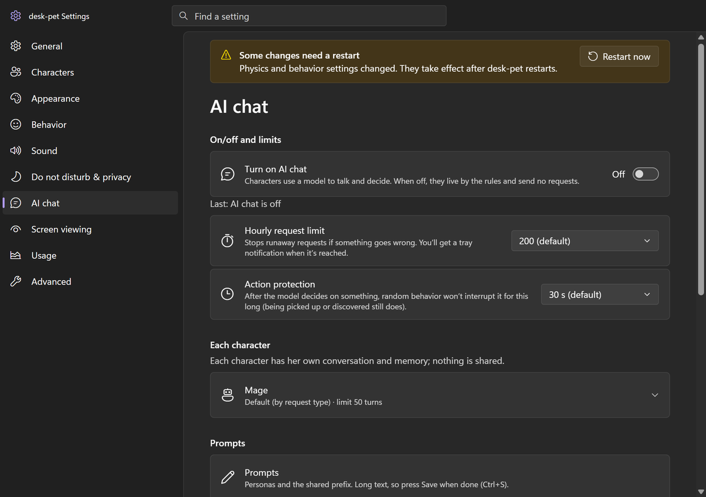

<div align="center">


# desk-pet

**Windows 11 像素桌宠框架**

住在你桌面上的角色：在窗口上走、躲在窗口后面、被点会有反应，<br>愿意的话还能接 LLM，让她们说话、自己决定接下来做什么。

[](LICENSE)


[English](README.md) · **中文**

    

<sub>自带的演示角色 <b>魔法师</b>（<code>packs/mage/</code>）</sub>

</div>

---

## 功能

- **桌面世界**：在地面、任务栏、窗口顶边上走；在支撑面之间跳；进出得去的窗口可以钻进去；窗口挪动、缩放时跟着走（窗口事件驱动，每秒全量扫一次兜底）。
- **躲藏与遮挡**：躲到窗口后面探头；被别的窗口盖住时探头、继续躲或走出来；遮挡她的窗口被挪开算“被发现”。
- **互动**：点、摸（按住移动）、拎起来、拖、扔（带物理）。反应写在数据里（`behaviors.json`），不写死在代码里。
- **行为系统**：带权重的行为、JSON Logic 条件、冷却、数值（体力、心情……）、好感、多步计划、解锁条件。可以多个角色同屏，托盘里选谁在桌面上。
- **不打扰**：全屏应用和 Windows 勿扰时自动藏起来，老板键（`Ctrl+Alt+H`），识别“用户离开”（锁屏 / 长时间不动键鼠），暂停。
- **LLM（可选，默认关）**：任何兼容 OpenAI Chat Completions 的服务都能写台词；可选的决策模型只在规则允许的动作里挑，由程序校验后执行。每个角色有自己的会话和长期记忆摘要（`data/memory.sqlite`）。说话用动森式的短音，不做 TTS。可选看屏幕（默认关，截图只在内存里）。每小时请求数 / 每日花费上限和用量统计。
- **设置窗口**中英双语（i18next），常用开关在托盘，开机自启（默认关）。
- **不往系统盘写东西**：Electron 默认写 `%APPDATA%` 的用户数据、缓存、日志都改到了项目里的 `data/`、`logs/`。

## 设置窗口

<p align="center">
  
  
  <br><sub>设置窗口：中英双语、浅色 / 深色</sub>
</p>

## 环境

- Windows 10/11（窗口位置、层级、勿扰状态经 [koffi](https://koffi.dev/) 调 Win32 API）
- Node.js 24 以上（TypeScript 直接靠 Node 的类型擦除运行；记忆和用量用 `node:sqlite`）

## 快速开始

```powershell
git clone https://github.com/zeroa234/desk-pet.git
cd desk-pet
npm install
npm start
```

第一次 `npm start` 会下载 Electron 本体（约 100 MB）。新版 npm 可能对 `koffi` 打一条 `allow-scripts` 警告，可以不管（koffi 自带预编译文件）。

魔法师会出现在桌面上，托盘里多一个图标。右键托盘图标打开菜单，或者打开 **设置**。

其它：

```powershell
npm run shortcut        # 在项目目录生成 desk-pet.lnk（双击启动；运行中再双击打开设置）
npm test                # 单元测试
npm run typecheck       # 类型检查（tsc，不产出文件）
npm run validate:packs  # 检查 packs/ 下所有角色包
```

## 开启 LLM

1. 改 `config/llm.json`：每个 provider 的 `baseUrl` / `model`（兼容 OpenAI Chat Completions 的服务都行）。`routes` 决定每种请求（台词、回话、反应……）用哪个 provider；`decision` 是可选的决策模型。
2. key 用 `keyEnv` 写的环境变量（默认 `OLLAMA_API_KEY`），或者写进 `config/secrets.local.json`：`{"<secretName>": {"api_key": "..."}}`。`*.local.*` 已在 `.gitignore` 里。key 不会进渲染进程，也不会写进日志。
3. 在托盘菜单或设置里打开 LLM。人设在 `packs/<id>/persona-sfw.md`，设置窗口里也能改。

## 做自己的角色

一个角色是 `packs/<id>/` 下的一个目录：清单 `pack.json`、预渲染的精灵图集（`sprites/<变体>/<衣着>/<动作>-<朝向>.png|.json`）、手写的 `behaviors.json`。格式见 [`docs/pack-format.md`](docs/pack-format.md)，加完跑 `npm run validate:packs`。

从 3D 模型渲染图集的导出器不在第一版里。

## 目录

```
src/
  main/       Electron 主进程：模拟（sim.ts）、窗口、托盘、设置、桌面追踪
  behavior/   状态机（actor）、选行为（brain、mind）、公共类型
  world/      支撑面（地面、窗口边）、导航、可见性
  platform/   Win32 绑定（窗口列表、层级、勿扰、键鼠空闲）
  stage/      透明覆盖窗口里的渲染
  settings/   设置窗口（原生 DOM + i18next）
  llm/        服务适配、请求队列、台词、决策、记忆、用量
  vision/     可选的看屏幕
  sound/      音效调度和说话短音
  pack/       角色包加载和校验
  locales/    中英文词条
tests/        node:test 单元测试（假桌面、假角色包）
packs/mage/   演示角色（见 NOTICE.md）
```

## 说明

- 引擎里保留了原项目的成人内容模式开关，**默认关闭**；本仓库**不带任何成人素材**，用演示包时这个开关没有可见效果。
- 角色包的 `pack.json` 必须写 `"adult": true`（意思是“角色是成年人”），否则拒绝加载。
- 代码注释大多是中文；部分注释在开源时省略了，标为“（开源版省略）”。

## 许可

代码：MIT（见 `LICENSE`）。演示包 `packs/mage/` **不适用 MIT**，见 [`NOTICE.md`](NOTICE.md)。
